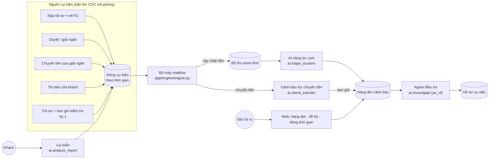

# Thiên La — Tài liệu thiết kế hệ thống

> Trợ lý AI truy vết đường dây gian lận và lừa đảo tín dụng. Bản thiết kế khớp với code trên nhánh `dev_nghi`.
> Nguyên tắc: **AI là bộ não, đồ thị là trí nhớ** — luật chỉ khoanh vùng rộng để không bỏ sót; mọi phán định có giá trị (kẻ gian hay nạn nhân hay vô hại) là việc của AI.
> Dữ liệu mô phỏng hoàn toàn (200.000 hồ sơ, thương hiệu "FinVay" hư cấu). Mọi con số dưới đây **đã đo** trên seed chuẩn `20261127` trừ khi ghi "mục tiêu".

---

## 1. Mục tiêu, định vị, phạm vi

**Định vị:** công cụ **B2B dùng chung cho 2 bên** trong mô hình cho vay tiêu dùng qua nền tảng ví điện tử.

| Bên | Vai trò | Thấy dữ liệu gì | Dùng Thiên La để |
|---|---|---|---|
| **Ngân hàng cho vay** | Thẩm định, giải ngân, thu nợ | Hồ sơ, phiên eKYC, giải ngân, lịch trả, các lần trả | Điều tra đường dây, dừng giải ngân hồ sơ nghi vấn, nhận diện nạn nhân, hậu kiểm quá hạn kỳ đầu |
| **Nền tảng ví** | Kênh phân phối + ví của khách | Dòng tiền **sau** giải ngân, tin báo của khách | Lá chắn, **cảnh báo lúc chuyển tiền**, cấp dòng tiền cho Lưới |

**Bối cảnh nghiệp vụ** (đối chiếu hợp đồng mẫu của một sản phẩm cho vay tiêu dùng qua nền tảng ví đang vận hành): mỗi người 1 ví/tài khoản chính chủ (eKYC theo CCCD); tiền giải ngân **vào tài khoản đứng tên khách**; mục đích ghi **"hoàn ứng vốn tự có phục vụ đời sống"** → không kiểm soát mục đích sau giải ngân; khách **tự chịu mọi tổn thất** kể cả khi bị lợi dụng. Hệ quả: dấu vết gian lận nằm ở **tín hiệu kỹ thuật lúc nộp**, **bối cảnh phiên eKYC**, **dòng tiền sau giải ngân**, **tin báo**, và **hành vi trả nợ**.

| | Nội dung |
|---|---|
| **Mục tiêu** | (1) Không bỏ sót ca có dấu vết. (2) Tách **kẻ gian cần chặn** khỏi **nạn nhân cần bảo vệ** khỏi **khách vô hại**. (3) Phát hiện **sớm** — cảnh báo theo thời gian thật, còn kịp dừng giải ngân. (4) Chứng minh bằng số rằng AI vượt luật cố định. |
| **Trong phạm vi** | Lá chắn (phân tích tin báo dạng chữ) · cảnh báo lúc chuyển tiền · bộ máy realtime + hàng đợi điều tra · đồ thị + dòng thời gian hồ sơ · agent điều tra · chỉ số + thời gian phát hiện · đăng nhập + bảo mật cơ bản · luồng trình chiếu. |
| **Ngoài phạm vi** | Voice/ghi âm, deepfake (nhận diện khuôn mặt giả là việc của nhà cung cấp eKYC), đọc ảnh, tích hợp hệ thống thật, hành động thật (chặn/khoá), dữ liệu khách thật. |

---

## 2. Kiến trúc tổng thể



| Thành phần | File | Vai trò |
|---|---|---|
| Sinh dữ liệu | `gen_data.py` | 7 bảng có mốc thời gian, cài sẵn đường dây + nhiễu; tự kiểm tra + baseline luật; `--seed` cho bộ chấm chéo |
| Dựng sẵn | `build.py` | Nạp **PostgreSQL** (COPY hàng loạt, ~1,3 triệu dòng) → cho bộ máy chạy qua **741.593 sự kiện** (~8 giây) → 347 cảnh báo → điều tra trước cảnh báo mới nhất của mỗi cụm |
| Bộ máy realtime | `app/engine/engine.py` | Xử lý từng sự kiện, cập nhật dần đồ thị, sinh cảnh báo; không nhìn trước tương lai |
| **AI** | `app/ai/`, `app/agents/investigation/`, `app/backend/integration/` | Gemini qua schema; Agent kế thừa BaseAgent, gọi tool và kiểm chứng nguồn; không đọc đáp án. Chưa có key → tự rơi về bản luật |
| Bản luật | `app/backend/mock_ai/` | Build/engine/mô phỏng dùng luật để dựng cảnh báo, kết luận mẫu và kiểm tra chuyển tiền nhanh; ghi rõ `mode` |
| Tool chỉ đọc | `app/backend/agent_tools.py`, `app/backend/store.py`, `app/tools/` | Tool backend có mốc `as_of`; tool graph đọc schema `graph`; dòng thời gian hồ sơ |
| Bảo mật | `app/security/`, `app/middleware/`, `app/backend/http/auth.py` | Đăng nhập đội rủi ro + phiên khách, phiên ký HMAC, PIN băm scrypt, giới hạn lượt gọi, header bảo mật |
| **App ví khách** | `app/backend/wallet/`, `web/vi/` | Khách đăng nhập SĐT + PIN: ví, khoản vay, hộp tin, báo lừa đảo, tra cứu người nhận, chuyển tiền — mỗi lần chuyển được chấm điểm 0–100, đối chiếu **đường dây đã điều tra** (`ring_accounts`), SIMO, tin báo; tạm giữ/báo lừa → cảnh báo vào hàng đợi ngay |
| **Mô phỏng hoạt động** | `app/backend/simulation/` | Tự sinh khoản vay + chuyển tiền ngẫu nhiên (bình thường / bị dụ vay / giả thu nợ / người thân nhờ gấp), đi qua đúng `execute_transfer` của app khách |
| Hạ tầng | `docker-compose.yml`, `Dockerfile`, `app/db/` | Postgres 16 (schema `public` / `graph` / `ai_cache`) + app trong container (user không phải root); `.env` chứa bí mật, không commit |
| Web | `app/main.py`, `web/` | FastAPI + 1 trang HTML/JS thuần + Cytoscape; feature-flow gắn ở `/flows` |

**Stack:** Python 3.12, FastAPI, **PostgreSQL 16** (psycopg 3) trong Docker, Cytoscape.js (dùng bản đóng gói sẵn của feature-flow, không gọi CDN), font Be Vietnam Pro; quản lý môi trường bằng `uv`.

---

## 3. Mô hình dữ liệu — nhiều bảng, mọi thứ có mốc thời gian

Cửa sổ dữ liệu **01/06 → 25/11/2026**. **Không có cột "quá hạn" chốt sẵn** — quá hạn tính tại từng thời điểm từ lịch trả + các lần trả.

| Bảng | Dòng | Mỗi dòng | Cột chính |
|---|---|---|---|
| `applications` | 200.000 | 1 hồ sơ | `applied_at → ekyc_completed_at → decided_at (decision) → disbursed_at`; khai báo (tên, CCCD, SĐT = mã ví, địa chỉ, 2 người tham chiếu, số tiền, mục đích); tín hiệu lúc nộp (thiết bị, IP + loại mạng + tỉnh theo IP, tuổi SIM, nhà mạng, hệ điều hành, giả lập, thời gian điền đơn); ví + eKYC tóm tắt (tuổi ví, thiết bị gắn ví bao lâu, máy hook/root, liveness, số lần thử); kỳ hạn 3 tháng, lãi 36%/năm |
| `ekyc_sessions` | 235.975 | 1 lần thử eKYC | thời điểm, thiết bị, liveness, máy hook, đạt/trượt |
| `repayment_schedule` | 519.342 | 1 kỳ trả | ngày đến hạn, gốc, lãi |
| `repayments` | 328.221 | 1 lần trả | thời điểm, kỳ, số tiền, kênh |
| `wallet_transfers` | 77.783 | 1 lần chuyển đi sau giải ngân | thời điểm, người nhận (loại, mã, ngân hàng, tên), số tiền, ghi chú; **ngữ cảnh người nhận**: có trong danh bạ + mới lưu bao lâu (so khớp trên máy khách, chỉ gửi cờ), đã từng chuyển chưa, SIMO gắn cờ, ví nhận bao nhiêu ngày tuổi + máy đã mở ví, có phải cửa hàng đã đăng ký |
| `scam_reports` | 105 | 1 tin báo | thời điểm, người gửi, kênh, **chỉ có chữ thô** (có 5 tin chứa câu tiêm lệnh nhắm vào AI) |
| `ground_truth.json` | — | đáp án | chỉ dùng để chấm (`/api/metrics`), **không bao giờ** vào bộ máy hay AI |

**Nội dung cài sẵn:**

| | Nhóm | Hồ sơ | Dấu vết |
|---|---|---|---|
| A | Ví bị thuê/mua | 8 | Vay xong chia tiền vào 6 tài khoản gom (2 ví + 4 ngân hàng, mỗi cái 1 tên); 23 tin báo rải trên 6 tài khoản, nối qua chung hotline/tên miền; 2 hồ sơ chờ giải ngân chỉ lộ qua thiết bị chung; không trả nợ |
| B | Tham chiếu chung, vay dồn dập | 15 | Chung 2 SĐT tham chiếu, xoay 3 thiết bị, vay trong 3 ngày (tháng 10), quá hạn ngay kỳ đầu |
| C | 1 người nhiều CCCD | 7 | 7 CCCD + 7 ví mới, tên/địa chỉ viết lệch, chung 1 thiết bị, nộp cách nhau 4–9 ngày |
| D | Trại SIM + VPN | 12 | SIM cùng lô mới 0–6 ngày, cùng dải IP datacenter/VPN, đa số giả lập, điền đơn < 70 giây lúc 0–5h (tháng 10), không trả |
| E | **Nạn nhân** bị dụ vay | 8 | Hồ sơ sạch; vay xong chuyển hết trong 10–60 phút tới 3 tài khoản có trong tin báo; 5 người tự kể bị lừa |
| F | Chiếm ví + vượt eKYC | 6 | Ví cũ sạch; thiết bị mới gắn ví 1–6 giờ (2 máy cho 6 vụ), máy hook, liveness 0,80–0,84, thử eKYC 2–4 lần, vay kịch hạn mức lúc 1–4h (tháng 10); **chủ ví là nạn nhân** |
| G | Ngủ đông | 10 | Ví nuôi 4–7 tháng, tín hiệu sạch, vay cùng đợt, dồn tiền về 3 tài khoản gom; chỉ 1 tin báo vào ngày cuối |
| H | **Nạn nhân một-một** | 20 | Mỗi người chuyển hết tiền vào 1 tài khoản MỚI riêng, ghi chú vô hại; 10 ví mới mở từ 2 máy trại (nối được), 10 ngân hàng ngoài (một nửa SIMO đã gắn cờ) |
| — | Kẻ gian lẻ loi | 5 | Mọi tín hiệu sạch, rút về ngân hàng chính chủ sau vài ngày rồi không trả. **Không kỳ vọng bắt trước** |

**Nhiễu vô hại cho từng tín hiệu:** ~4.000 gia đình (chung địa chỉ/tham chiếu/thiết bị, chuyển tiền cho nhau), 100 ký túc xá, ~2.000 chủ trọ + 150 trường + 300 cửa hàng nhận tiền của nhiều người vay, ~4% dùng VPN, ~5% vừa đổi SIM, ~3% vừa mua máy mới, ~15% phải thử eKYC lại, ~15% rút nhanh về ngân hàng chính chủ, ~6% nợ xấu thật không do gian lận.

---

## 4. Bộ máy realtime (`app/engine/engine.py`)

**Sự kiện** (sắp theo thời gian): `apply` (nộp hồ sơ) · `transfer` · `report` · `repayment` · `due_check` (đến hạn kỳ 1 + 10 ngày — lịch hẹn giờ của chính hệ thống, không phải dữ liệu tương lai).

**Mỗi sự kiện chỉ chạm cụm của nó:**
1. **Chuyển tiền** → chạy ngay *cảnh báo lúc chuyển tiền* (chỉ dùng tin báo **đã có tới giờ**) → nếu tạm giữ thì sinh cảnh báo giao dịch.
2. **Cập nhật đồ thị (union-find, chỉ nối thêm):** nối hồ sơ qua điểm dùng chung — thiết bị, SĐT tham chiếu, dải IP VPN/datacenter, lô SIM mới, **nơi nhận tiền đã siết** (≤ 2h sau giải ngân, ≥ 30% khoản vay, chưa từng chuyển, không phải cửa hàng đã đăng ký), máy đã mở ví nhận, tài khoản/hotline trong tin báo, người tự báo. Tín hiệu "dùng chung" chỉ gắn cho hồ sơ **thật sự** dùng chung khoá đó.
3. **Đánh giá cụm vừa đổi:** đếm tín hiệu (tham chiếu chung ≥ 5, thiết bị chung ≥ 5, nơi nhận chung, ≥ 2 hồ sơ cùng quá hạn kỳ đầu, IP/SIM/giả lập, eKYC bất thường, SIMO, tin báo) và **số hồ sơ đang chờ tại thời điểm đó** (theo `decided_at`/`disbursed_at`, không dùng trạng thái cuối).
4. **AI sàng lọc** quyết định có đáng điều tra không + độ tin cậy.
5. **Chống báo lặp:** chỉ sinh cảnh báo khi cụm có **bằng chứng mới** (thêm tín hiệu, thêm tin báo, lớn thêm, đổi số hồ sơ chờ). 2 cụm nhập lại thì giữ mã cụm cũ → diễn biến liền mạch.

**Cảnh báo:** mức **Khẩn** (có hồ sơ đang chờ + bằng chứng mạnh, hoặc giao dịch bị tạm giữ) / **Cao** / **Trung bình**; **ưu tiên** = mức × 10 + tin cậy × 10 + min(quy mô, 10) + 2 × hồ sơ đang chờ.

**Quá hạn kỳ đầu đứng riêng = rủi ro tín dụng, không cảnh báo.** Nằm trong cụm có quan hệ thì làm cụm nặng thêm (7 cảnh báo loại này).

**Kết quả trên seed chuẩn:** 741.593 sự kiện → **347 cảnh báo** (123 cụm, 60 giao dịch tạm giữ), ~8 giây. Bản thi **phát lại** kết quả theo đồng hồ tua nhanh (`/api/live`); chạy thật thì bộ máy đọc thẳng hàng đợi sự kiện — code xử lý giống hệt. *ponytail:* trạng thái giữ trong RAM 1 tiến trình; chạy thật cần lưu snapshot.

---

## 5. Những chỗ AI làm việc (`app/ai/`, `app/agents/investigation/`)

Luồng trực tiếp từ app khách nay có outbox PostgreSQL, cập nhật graph theo
sự kiện, sàng lọc và tự gọi Agent. Tool đọc được khoản vay KL/giao dịch KT,
tách held khỏi tiền đã chuyển. Chi tiết và giới hạn: [ai_realtime.md](ai_realtime.md).

Các API tương tác dùng Gemini qua `LLM_API_KEY`/`LLM_MODEL_NAME` và **tool schema**.
`backend/integration/` đổi hợp đồng web sang AIService và InvestigationAgent. Engine/build
vẫn dùng `backend/mock_ai/` để dựng mẫu offline; chưa tự gọi AI entity resolution/triage
trong mỗi lần phát lại toàn bộ sự kiện. Chi tiết triển khai: `docs/backend_integration.md`.

| Hàm | Vào | Ra | Ghi chú |
|---|---|---|---|
| `analyze_report(text)` | Tin báo (≤ 2.000 ký tự) | `verdict` scam/suspicious/safe, `confidence`, `reporter_is_victim`, `indicators` (tài khoản, SĐT/ví, link), `reasons`, `advice` | Phần **chuẩn hoá số** (`o→0`, bỏ dấu cách/chấm) là tất định, giữ lại cả khi dùng AI. Tin báo bọc trong thẻ, coi là dữ liệu |
| `check_transfer(ctx)` | Ngữ cảnh khoản vay vừa giải ngân + người nhận | `allow` / `warn` / `hold` + lý do + lời nhắn cho khách | Người nhận quen (đã chuyển nhiều lần, có trong danh bạ từ lâu) → cho phép |
| `triage_clusters(summaries)` | Bản tóm tắt số liệu cụm (**không PII**) | `investigate`/`skip` + độ tin cậy + nghi loại gì + lý do | Gọi theo nhu cầu khi cụm đổi, không theo từng sự kiện |
| `investigate(cluster, tools, as_of)` | Ảnh chụp cụm lúc cảnh báo | Từng bước + `case`: `fraud_ring`/`victims`/`benign`/`inconclusive`, thành viên, nạn nhân, bằng chứng, việc cần làm | **Chỉ thấy dữ liệu tới `as_of`**. Thử giả thuyết vô hại trước. Phân biệt nạn nhân: chính thành viên trong cụm tự kể bị lừa |

**Tool chỉ đọc của backend** (`app/backend/agent_tools.py`, khóa `as_of` theo snapshot):
`cluster_money_flow`, `get_cluster`, `get_transfer`, `get_application`, `tech_profile`, `money_flow`,
`account_senders`, `reports_mentioning`, `timeline`. Agent không có quyền hành động thật.

**Đánh giá chi tiết hiện tại:** tool tổng hợp dòng tiền cả cụm có mã bản ghi
nguồn; đầu ra tách mức nghi vấn của cụm khỏi vai trò từng hồ sơ và ghi rõ
phần chưa đánh giá. Mọi vai trò đều chưa xác minh. Xem
[đánh giá cụm và vai trò](cluster_assessments.md).

**Kho tri thức và việc “học”:** graph lưu dấu vết từ tin báo (tài khoản, số
điện thoại, URL/tên miền), quan hệ giao dịch và nhận định có nguồn. Bổ sung
dữ liệu giúp truy vấn có thêm ngữ cảnh; hiện không có huấn luyện/fine-tune
model tự động hay vòng học online từ toàn bộ giao dịch. API Lá chắn độc lập
trả phân tích; tin được báo từ hộp thư app khách đã nối qua outbox để kiểm
tra nguồn rồi ghi graph. Không tự thu mọi nội dung người dùng chỉ đem phân tích. Chi tiết:
[tích hợp dữ liệu và graph](ai_pipeline.md#tích-hợp-dữ-liệu-và-graph).

**Hợp nhất thực thể mờ** (C: "Ng V. A" = "Nguyễn Văn A") là việc AI nên làm thêm — hiện C mất **27 ngày** mới bị cảnh báo vì phải đủ 5 hồ sơ chung thiết bị.

---

## 6. API

| Method | Path | Đăng nhập | Ghi chú |
|---|---|---|---|
| POST | `/api/login`, `/api/logout`; GET `/api/me` | — | Phiên cookie HttpOnly |
| POST | `/api/shield/analyze` · GET `/api/shield/samples` | Không | Lá chắn công khai cho khách |
| GET | `/api/overview`, `/api/metrics` | Không | Chỉ số đếm tổng hợp, không PII |
| GET | `/api/transfer/samples` · POST `/api/transfer/check` | **Có** | `transfer_id` theo mẫu `CKnnnnn` |
| GET | `/api/alerts` | **Có** | Lọc `day`, `date_from/to`, `hour_from/to`, `severity`, `kind`, `verdict`, `min_conf`, `latest`, `q`; `sort` = priority/time/confidence/size; `limit` ≤ 500 |
| GET | `/api/alerts/days`, `/api/alerts/hours?day=` | **Có** | Đếm theo ngày / theo giờ trong ngày |
| GET | `/api/alerts/{id}` · `/api/alerts/{id}/investigate` (SSE) | **Có** | Đồ thị con + diễn biến cụm; điều tra với `as_of` = lúc cảnh báo |
| GET | `/api/apps/{id}?as_of=` | **Có** | Dòng thời gian hồ sơ + quá hạn tại `as_of` (đã tối thiểu hoá PII) |
| GET | `/api/live?start=&day_seconds=` (SSE) | **Có** | Phát lại realtime |
| POST | `/api/khach/login`, `/api/khach/logout` · GET `/api/khach/demo` | — | Phiên khách riêng (cookie `tl_khach`); `demo` chỉ trả SĐT demo, không bao giờ trả PIN |
| GET | `/api/khach/me`, `/api/khach/inbox`, `/api/khach/transfers` | **Khách** | Chỉ dữ liệu của chính khách đang đăng nhập |
| POST | `/api/khach/inbox/{id}/read`, `/api/khach/report/{id}` | **Khách** | Báo lừa: chỉ báo được tin trong hộp tin của mình → phân tích + ghi tin báo + cảnh báo `LV…` |
| GET | `/api/sim` · POST `/api/sim/start {interval}`, `/api/sim/stop` | **Có** | Bộ mô phỏng hoạt động: trạng thái, bộ đếm, 15 sự kiện gần nhất; tự dừng sau 2.000 sự kiện |
| POST | `/api/khach/loan`, `/api/khach/transfer` | **Khách** | Vay nhanh (≤ 20 triệu) · chuyển tiền: `allow` / `warn` (cần xác nhận lại) / `hold` (tiền không rời ví, sinh cảnh báo) |

---

## 7. Giao diện (`web/`)

Tông hồng magenta, font Be Vietnam Pro. **Màn đội rủi ro** (`/`) gồm 4 màn; **app ví khách** ở `/vi/`:

| Màn | Nội dung |
|---|---|
| **Tổng quan** (công khai) | Phễu (sự kiện → hồ sơ có tín hiệu → cụm → cảnh báo → kết luận) · so với luật cố định · bảng **thời gian phát hiện** theo nhóm |
| **Lá chắn** (công khai) | Dán tin hoặc chọn mẫu → đỏ/vàng/xanh, lý do, dấu vết, số người đã báo, lời khuyên |
| **Chuyển tiền** | Giao dịch thật trong dữ liệu → Tạm giữ/Cảnh báo/Cho phép + khung thông báo trong app ví + ngữ cảnh người nhận |
| **Lưới & Thám tử** | Biểu đồ cảnh báo **theo ngày** (có nhãn) + **dải 24 giờ** (lọc giờ hoặc khung Đêm/Sáng/Chiều/Tối) · lọc mức độ/loại/kết luận/độ tin cậy/tìm mã · sắp xếp ưu tiên/mới nhất/tin cậy/quy mô · **▶ Phát realtime** · đồ thị cụm (giới hạn zoom, tự căn khi đổi kích thước) · diễn biến cụm · bấm hồ sơ → **dòng thời gian** · điều tra từng bước · tự làm mới mỗi 15 giây khi có cảnh báo mới từ app khách |
| **App ví khách** (`/vi/`) | Đăng nhập SĐT + PIN · số dư, khoản vay, kỳ trả tới, danh bạ · **hộp tin** (tin chính thức + tin lạ) → *Báo lừa đảo* hoặc *Làm theo hướng dẫn* (đóng vai nạn nhân: điền sẵn form chuyển tiền) · vay nhanh · chuyển tiền (có ô *lưu vào danh bạ*) → màn kết quả Tạm giữ / Khoan đã + *Vẫn chuyển* / Thành công · lịch sử |

**6 tình huống trong app khách (đã chạy thử bằng `tests/smoke.py`):**

| Khách | Tình huống | Luật bắt (giả lập) | Kết quả |
|---|---|---|---|
| 1 | Dụ vay rồi chuyển — tài khoản đã bị 4 người báo | Tài khoản bị báo + rút gần hết khoản vay cho người lạ | **Tạm giữ** |
| 1 | Giả bên thu hồi nợ — nộp "phí phạt" vào tài khoản công ty | Nội dung trả nợ/tất toán + người nhận chưa quen | **Tạm giữ** (FinVay chỉ thu nợ trong app) |
| 2 | Dụ vay rồi chuyển — tài khoản SIMO gắn cờ | SIMO | **Tạm giữ** |
| 2 | Link giả "tất toán giảm 50% lãi" đòi OTP | Link lạ + đòi OTP | Lá chắn: **Lừa đảo** |
| 3 | Dụ vay rồi chuyển — tài khoản mới tinh, dặn lưu danh bạ | Vay xong chuyển hết + số vừa lưu 0 phút + nội dung "xác minh" | **Tạm giữ** |
| 3 | "Mẹ" nhắn Zalo nhờ chuyển gấp 3 triệu | Phần lớn số dư cho người lạ lần đầu + lời thúc giục | **Cảnh báo** (có thể là người thân thật → khuyên gọi xác minh, khách tự quyết) |
| cả 3 | Báo nhầm tin chính thức (kênh brandname đã xác thực) | Người gửi đã xác thực, không link/tài khoản lạ | **An toàn**, không sinh cảnh báo |
| cả 3 | Chuyển 200 nghìn cho người thân đã lưu từ lâu | Người nhận quen | **Cho phép**, không làm phiền |

**Mô phỏng hoạt động** (đo 1 lần chạy ~20 giây): 29 khoản vay, 28 giao dịch → lừa bị chặn **8/8**, giao dịch bình thường bị làm phiền **0**.

**Kịch bản demo đầu-cuối (đã chạy thử):** 3 khách demo, mỗi người nhận 1 kiểu tin lừa — tài khoản đã bị 4 người báo / tài khoản SIMO gắn cờ / tài khoản mới tinh kèm lời dặn *lưu số vào danh bạ*. Cả 3 làm theo tin → vay → chuyển: **cả 3 bị tạm giữ, tiền không rời ví**; chuyển 200 nghìn cho người thân đã lưu từ lâu thì **không bị làm phiền**; 6 cảnh báo `LV…` hiện trên hàng đợi đội rủi ro.

---

## 8. Đánh giá

**Baseline luật đơn lẻ** (đã đo; 58 hồ sơ gian lận, 28 nạn nhân):

| Luật | Gắn cờ | Gian lận | Nạn nhân bị coi là kẻ gian |
|---|---|---|---|
| SĐT tham chiếu chung ≥ 3 hồ sơ | 9.052 | 15/58 | 0/28 |
| Chuyển ≥ 80% tiền trong 1 giờ (lần đầu) | 26.169 | 26/58 | 20/28 |
| IP VPN/datacenter hoặc SIM < 30 ngày | 17.722 | 18/58 | 2/28 |
| Thiết bị chung ≥ 2 hồ sơ | 3.616 | 32/58 | 0/28 |
| Phiên eKYC bất thường | 15.755 | 18/58 | 2/28 |
| **Gộp 5 luật** | **61.306** | **54/58** | **21/28** |

Luật cũ trượt vì 2 lỗ kinh điển: **chia nhỏ tiền** (A chuyển 2–3 lần, mỗi lần < 80%) và **chuyển chậm** (H sau 60–90 phút).

**Lớp ứng viên đã vá** (gộp tiền chuyển trong 2h cho người khác tên + nơi nhận chung đã siết + SIMO + tín hiệu tĩnh): **58/58 gian lận, 28/28 nạn nhân** trên cả seed chuẩn (41.073 cờ) và seed chấm chéo 7. *Seed 7 cùng cơ chế sinh — chứng minh không khớp đề theo con số, chưa chứng minh chịu được thủ đoạn mới.*

**Cảnh báo lúc chuyển tiền:** gộp 2h ≥ 80% cho người khác tên → 627 cờ; thêm ngữ cảnh người nhận (ngoài danh bạ hoặc mới lưu < 3h, chưa từng chuyển, hoặc SIMO) → **320 cờ**, vẫn 28/28 nạn nhân. Luật từ khoá "phí/xác minh" bắt 8/8 nhóm E nhưng **0/20 nhóm H** (ghi chú vô hại) và dính "học phí" — chỗ cần AI đọc ngữ cảnh.

**Toàn bộ đường đi ở chế độ chưa có AI (mốc để AI phải vượt):** kết luận 356 hồ sơ là kẻ gian → đúng **58/58**, **0 nạn nhân bị nhầm**, nhưng **nhầm 298 hồ sơ vô hại**; nhận ra **22/28** nạn nhân. Mục tiêu khi cắm AI: < 150 hồ sơ phải xem tay, precision ≥ 80%, recall ≥ 85%, 0 nạn nhân bị nhầm.

**Thời gian phát hiện** (hồ sơ đầu tiên của nhóm → cảnh báo đầu tiên): A **18 phút** · E **42 phút** · H **48 phút** · D **1 ngày** · B **1 ngày** · G **1 ngày** · F **4 ngày** · C **27 ngày**. Kẻ lẻ loi: không cảnh báo; chỉ còn dấu vết hậu kiểm (quá hạn 47–49 ngày tại 25/11).

---

## 9. Bảo mật (đã rà soát và sửa — `app/security/`)

| Lớp | Biện pháp | Đã kiểm tra |
|---|---|---|
| **Chế độ demo** | `DEMO_AUTOFILL=1` trả mật khẩu đội rủi ro + PIN khách demo cho trình duyệt để tự đăng nhập — **chỉ bật khi trình diễn**; bỏ cờ là về đăng nhập thường | Tắt cờ: `/api/me` và `/api/khach/demo` không còn trả mật khẩu/PIN |
| **Xác thực khách** | SĐT + PIN 6 số; PIN băm **scrypt** + muối riêng từng tài khoản; phiên khách cookie riêng `tl_khach` (HMAC, HttpOnly, SameSite=Strict, 2 giờ); **cùng 1 thông báo** cho sai SĐT và sai PIN (không dò được SĐT nào có tài khoản); đăng nhập 5 lần/phút; mọi truy vấn lọc theo SĐT của phiên → khách không đọc được dữ liệu người khác | PIN sai → 401; cookie khách giả → 401; khách gọi API đội rủi ro → 401 |
| **Xác thực đội rủi ro** | Mật khẩu qua biến môi trường `THIENLA_PASSWORD`; phiên = cookie ký **HMAC-SHA256** (`THIENLA_SECRET`), **HttpOnly, SameSite=Strict, Secure** khi chạy HTTPS, hết hạn 8 giờ; so sánh hằng thời gian | Chưa đăng nhập → 401; cookie giả → bị từ chối |
| **Phân quyền** | Cần đăng nhập: hàng đợi, đồ thị, hồ sơ, chuyển tiền, phát realtime, **bật/tắt mô phỏng**. Công khai: Lá chắn, tổng quan, chỉ số tổng hợp | ✔ |
| **Chống lạm dụng** | Giới hạn lượt theo IP: đăng nhập 5/phút, Lá chắn 30/phút, phát realtime 6/phút, điều tra 12/phút, kiểm tra chuyển tiền 60/phút, còn lại 600/phút. Chỉ tin `X-Forwarded-For` khi đặt `THIENLA_BEHIND_PROXY` | Dò mật khẩu lần thứ 6 → 429 |
| **Header** | CSP (`script-src 'self'`, chặn nhúng khung, `base-uri 'none'`), X-Frame-Options DENY, nosniff, Referrer-Policy no-referrer, Permissions-Policy; API `Cache-Control: no-store`; `/flows` giữ CSP riêng của feature-flow | ✔ |
| **Đầu vào** | Pydantic: tin nhắn ≤ 4.000 ký tự, mã giao dịch theo mẫu, mật khẩu ≤ 200; kiểm định dạng ngày giờ (400 thay vì 500); `limit` ≤ 500; giờ trong [0, 24] | Mã chèn SQL → 422; ngày bẩn → 400 |
| **SQL** | Mọi giá trị qua tham số `?`; cột sắp xếp chọn từ danh sách cố định | Chuỗi chèn SQL ở ô tìm kiếm không làm lộ dữ liệu |
| **XSS** | Giao diện escape mọi dữ liệu trước khi chèn HTML; đồ thị vẽ bằng canvas | ✔ |
| **Lộ API** | Khi đặt mật khẩu web, tắt `/docs`, `/redoc`, `/openapi.json`; local không mật khẩu giữ Swagger để test | 404 khi có mật khẩu |
| **Dữ liệu cá nhân** | Dữ liệu mô phỏng 100%. Vẫn làm như thật: SĐT/CCCD che 4 số giữa; dòng thời gian chỉ hiện **năm sinh + tỉnh**; sàng lọc AI chỉ nhận số liệu tổng hợp; danh bạ so khớp **trên máy khách**, chỉ gửi cờ; đáp án chỉ trả số tổng hợp; thư mục `data/` không được phục vụ | Hồ sơ trả về: `1973`, `Đồng Nai`, `082****339` |
| **Prompt injection** | Tin báo là dữ liệu không tin cậy (có 5 tin tiêm lệnh trong bộ thử); đầu ra AI qua schema; agent chỉ có tool đọc, không hành động thật | Lá chắn giả lập: 5/5 tin tiêm lệnh vẫn ra "lừa đảo"; toàn bộ 105/105 tin phân loại đúng |
| **Hạ tầng** | Postgres chỉ mở cổng cho `127.0.0.1` (không ra mạng ngoài); container app chạy bằng user không phải root; bí mật chỉ nằm trong `.env` | `whoami` trong container → `thienla` |
| **Bí mật** | `.env`, `*.db`, `data/` nằm trong `.gitignore`; repo không chứa tên ngân hàng thật hay dữ liệu khách | Grep trước mỗi lần push |

**Còn lại khi lên môi trường thật:** 1 tài khoản dùng chung (chưa phân vai, chưa có nhật ký truy cập theo người); giới hạn lượt gọi giữ trong RAM (nhiều tiến trình → Redis); chưa có CSRF token riêng (đang dựa vào SameSite=Strict + API JSON); app dùng 1 kết nối Postgres chung giữa các luồng (psycopg 3 cho phép; nhiều người dùng đồng thời → chuyển sang connection pool); PIN demo dùng chung cho 3 tài khoản demo (bản thật: mỗi khách 1 PIN, khoá tạm sau N lần sai).

---

## 10. Triển khai

1 VPS nhỏ **tách biệt hạ tầng công ty**; **Docker Compose** chạy Postgres + app; **Caddy** làm reverse proxy + HTTPS tự động.

```bash
cp .env.example .env     # POSTGRES_PASSWORD, THIENLA_PASSWORD, THIENLA_SECRET=$(openssl rand -hex 32), DEMO_PIN, THIENLA_BEHIND_PROXY=1
                         # demo: DEMO_AUTOFILL=1 (tự đăng nhập), SIM_AUTOSTART=1 (bật mô phỏng sẵn)
docker compose up -d db
uv sync && python gen_data.py && uv run python build.py        # build XOÁ SẠCH schema public rồi dựng lại (cũng là cách reset demo)
docker compose --profile app up -d --build                     # app ở 127.0.0.1:4420 — Caddy proxy ra ngoài
```

```
thien-la/
├── gen_data.py · build.py · docker-compose.yml · Dockerfile · .env.example
├── app/  main.py · engine.py · db.py · security.py · khach.py (app ví) · sim.py (mô phỏng) · middleware/ · backend/ · ai/ · agents/ · graph/ · tools/
├── web/  index.html · app.js · style.css (đội rủi ro)  ·  vi/ index.html · vi.js · vi.css (app khách)
├── flows/build_flows.py · flows/backend_agent.py · flows/batch_ai.py · flows/realtime_ai.py → docs/flows/*.json  (12 luồng trình chiếu)
├── tests/  176 test (unittest) · smoke.py (62 phép thử API đầu-cuối)
└── docs/ system_design.md · huong_dan_su_dung.md · Thien_La_gioi_thieu.docx · hdsd/ · tools/
```

---

## 11. Rủi ro mở

| Rủi ro | Mức | Giảm thiểu |
|---|---|---|
| Dữ liệu tự sinh bị xem là dàn dựng | Cao | Seed chấm chéo; công khai cơ chế; nhiễu cho từng tín hiệu; công bố cả ca không bắt được (lẻ loi 0/5, C chậm 27 ngày) |
| Chưa cắm AI thật → luận điểm "AI là lõi" chưa có số | Cao | Mốc giả lập đã đo (nhầm 298 vô hại); đo AI trên đúng các mốc đó ngay khi có key |
| Sàng lọc gạt nhầm cụm thật | Trung bình | Đo recall riêng; cụm có tin báo luôn giữ |
| Bị lạm dụng khi giám khảo dùng thử | Thấp | Đăng nhập + giới hạn lượt + hạn mức chi tiêu API |

---

## 12. Đối chiếu thủ đoạn thực tế 2026

Thiên La đứng ở **phía bên cho vay qua ví điện tử**. Một công cụ không bao phủ mọi thủ đoạn; bảng dưới ghi rõ phần làm được, phần không, và đường dây mô phỏng tương ứng.

| # | Thủ đoạn (nguồn) | Thiên La làm được | Không làm được | Mô phỏng |
|---|---|---|---|---|
| 1 | **Dụ vay rồi chuyển tiền giải ngân cho kẻ lừa.** Tiếp cận qua quảng cáo vé máy bay rẻ hoặc giả cơ quan chức năng → hướng dẫn cài ví/app tài chính (bài nêu đích danh Home Credit, Viettel Money, **MoMo**) → nạn nhân tự vay, tự xác thực khuôn mặt → viện cớ "xác minh, nộp phí, hoàn tiền" để nạn nhân chuyển toàn bộ tiền vay; nạn nhân vẫn phải trả nợ. Ca 03/11/2026 mất 120 triệu. [1] | eKYC **không** chặn được vì chính chủ tự vay. Thiên La bắt ở **dòng tiền**: vay xong chuyển hết trong vài chục phút tới tài khoản đã bị báo → xếp là **nạn nhân**, đề xuất giữ tiền/hỗ trợ thay vì đưa vào danh sách đen. Lá chắn cảnh báo ngay khi khách dán tin "phí xác minh". | Ngăn khách chuyển tiền khi chưa ai báo tài khoản đó (chỉ còn tín hiệu "chuyển hết cho người lạ ngay sau giải ngân") | **E** |
| 2 | **Mua bán, thuê tài khoản + công cụ qua mặt sinh trắc.** Đường dây gần 1.000 tài khoản (Công an Thanh Hoá) phục vụ đánh bạc, rửa tiền; mua phần mềm vô hiệu hoá sinh trắc, dựng video từ ảnh chụp sẵn của chủ tài khoản. [2] NHNN yêu cầu ngân hàng phát hiện, ngăn AI/deepfake trong xác thực; phạt 100–250 triệu theo NĐ 340/2025. [3] | Ví thuê/mua vay xong **chia tiền vào nhóm tài khoản gom**; nhiều ví cùng đổ về một chỗ, nối với hotline/tên miền trong tin báo → lộ cả đường dây, kể cả hồ sơ đang chờ giải ngân qua thiết bị chung. | Phát hiện video/khuôn mặt giả (việc của nhà cung cấp eKYC) | **A**, **F** |
| 3 | **Chiếm tài khoản đã xác thực sinh trắc.** Dùng dữ liệu lộ đăng nhập trên thiết bị chuẩn bị sẵn → mã độc/"camera ảo" + deepfake khuôn mặt chủ tài khoản → rút tiền; công cụ được rao bán. (Công an Cà Mau) [4] | Với khoản vay (bắt buộc eKYC lúc vay): bắt **bối cảnh quanh phiên eKYC**: thiết bị mới gắn với ví vài giờ, máy root/hook, liveness sát ngưỡng hoặc thử nhiều lần, ví cũ vay kịch hạn mức rồi chuyển hết cho người lạ. Cần SDK eKYC trả các cờ này. | Chặn rút tiền có sẵn trong ví (không phải khoản vay); nhận diện deepfake | **F**  |
| 4 | **Mạo danh ngân hàng/tổ chức, tin nhắn brandname giả** đòi OTP, mật khẩu, chuyển tiền "trả nợ", "nhận hoàn tiền" (Bộ Công an, nhóm 1). [5] | Lá chắn: phán tin, trích tài khoản/ví/hotline/tên miền, đếm số lượt đã bị báo; chống cả tin chứa câu tiêm lệnh. | Chặn tin trước khi đến máy khách (việc của nhà mạng) | tin báo `scam_*` |
| 5 | **Link giả, QR độc, app mã độc, phần mềm điều khiển từ xa** chiếm thiết bị (Bộ Công an, nhóm 5). [5] | Lá chắn nhận ra link/tên miền giả trong tin; phía cho vay thấy hệ quả (thiết bị lạ, hook) như mục 3. | Quét mã độc trên máy khách | tin báo có URL giả |
| 6 | **Deepfake giọng/hình người thân** gọi video vay tiền gấp (Bộ Công an, nhóm 2). [5] | Chỉ khi khách dán tin nhắn chữ đi kèm vào Lá chắn. | Phân tích cuộc gọi/video (ngoài phạm vi: không làm voice) | — |
| 6b | **Mỗi kẻ lừa 1 nạn nhân, mỗi lần 1 tài khoản mới** (ca xấu nhất) | Cảnh báo lúc chuyển tiền (mục 8 + mục 5); nối qua dấu vết mở ví hoặc qua kịch bản lừa lặp lại | Truy kẻ gian khi tài khoản là ngân hàng ngoài + kịch bản riêng + nạn nhân không báo | **H**  |
| 7 | **Giả cán bộ ngân hàng, dựng hồ sơ "vay đáo hạn" giả** để huy động tiền rồi chiếm đoạt. [6] | Lá chắn nếu khách dán lời mời. | Nằm ngoài luồng cho vay của bên cho vay | — |

**Thông điệp:** không hệ thống nào bắt được kẻ gian chưa để lại dấu vết. Thiên La phủ phần **dòng tiền và quan hệ giữa các hồ sơ ở phía bên cho vay**, và rút thời gian từ nạn nhân đầu tiên đến lúc chặn cả đường dây xuống còn vài phút. Thủ đoạn số 1 (nguồn nêu đích danh MoMo) là ca demo chính.

**Nguồn** (đã đọc bài gốc ngày 27/11/2026):
1. Công an tỉnh An Giang, *Cảnh báo thủ đoạn lừa đảo dụ dỗ vay tiền qua ứng dụng tài chính trực tuyến*, 09/11/2026: <https://congan.angiang.gov.vn/canh-bao-thu-doan-lua-dao-du-do-vay-tien-qua-ung-dung-tai-chinh-truc-tuyen>
2. Vietstock (theo VietNamNet), *Triệt phá đường dây gần 1.000 tài khoản, lộ thủ đoạn qua mặt sinh trắc học*, 26/06/2026: <https://vietstock.vn/2026/06/triet-pha-duong-day-gan-1000-tai-khoan-lo-thu-doan-qua-mat-sinh-trac-hoc-757-1458887.htm>
3. CafeF (theo Người Lao Động), *Ngân hàng Nhà nước cảnh báo thủ đoạn lừa đảo mới nhất liên quan dữ liệu sinh trắc học*, 20/04/2026: <https://cafef.vn/ngan-hang-nha-nuoc-canh-bao-thu-doan-lua-dao-moi-nhat-lien-quan-du-lieu-sinh-trac-hoc-188260420200728924.chn>
4. CafeF (theo Nhịp sống Thị trường), *Đã xác thực sinh trắc học, vì sao lừa đảo vẫn rút được số tiền lớn từ tài khoản nạn nhân?*, 06/05/2026: <https://cafef.vn/da-xac-thuc-sinh-trac-hoc-vi-sao-lua-dao-van-rut-duoc-so-tien-lon-tu-tai-khoan-nan-nhan-188260506160917319.chn>
5. Cổng TTĐT Bộ Công an, *Nâng cao cảnh giác trước 25 kịch bản lừa đảo trên không gian mạng năm 2026*, 08/09/2026: <https://bocongan.gov.vn/bai-viet/nang-cao-canh-giac-truoc-25-kich-ban-lua-dao-tren-khong-gian-mang-nam-2026-1788865614> (phần chữ chỉ mô tả 5 nhóm thủ đoạn; danh sách đủ 25 kịch bản không có trong nội dung đọc được)
6. Vietnam+ (TTXVN), *Cảnh giác chiêu trò mạo danh cán bộ ngân hàng*, 27/11/2026: <https://www.vietnamplus.vn/canh-giac-chieu-tro-mao-danh-can-bo-ngan-hang-post1150889.vnp>
